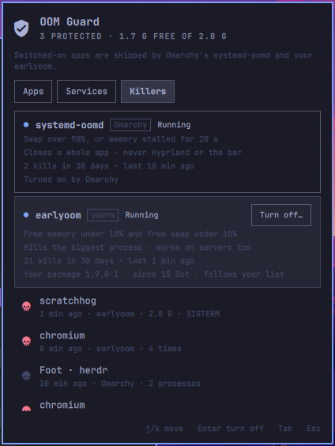

# OOM Guard for Omarchy

Choose the apps and services that must not be killed when your memory runs out.

| Apps and single windows | Both killers | Services |
|---|---|---|
|  |  |  |

## Install

```bash
omarchy plugin add https://github.com/Zeus-Deus/earlyoom-omarchy-plugin.git --enable --yes
```

That is all Omarchy's own OOM killer (systemd-oomd) needs. If you also run
earlyoom, which Omarchy does not ship, click **Link…** in the panel once, or run:

```bash
sudo bash ~/.config/omarchy/plugins/io.github.zeus-deus.oomguard/helper/install.sh
```

Update: `omarchy plugin update io.github.zeus-deus.oomguard`, then `omarchy-restart-shell`.
If an update changes the earlyoom link, the panel says the link is out of date
and offers **Relink…**.

## What it does

Click the shield in the bar. Every app, window and user service has a switch.
Turn it on and it is skipped the next time memory runs out.

- **Apps**: the app's windows are protected straight away, and so are windows it
  opens later. An app you protected keeps its switch even while it is closed.
- **Single windows**: under each app, one row per window shows its workspace,
  its title and, for a terminal, the program running in it (`herdr`, `nvim`,
  `btop`). Protect just that window, not every terminal. Press `f` or click
  the eye to jump to the window. A window rule ends when the window closes.
- **Services**: user services such as Syncthing or a voice daemon. Protection
  takes effect when the service restarts; press `r` on the row to do that now.
- **Killers**: Omarchy's systemd-oomd and your own earlyoom side by side: who
  owns each, whether it runs, when it acts, how often it killed in the last 30
  days, and the kills themselves. earlyoom can be turned on or off, linked to
  your list, installed or removed from here.

The line under the title tells you which killers are running and whether your
list reaches all of them.

## How it works

Omarchy turns on **systemd-oomd**. When memory or swap runs out it kills one
whole app, but only apps inside `app.slice`, the group that every app you
launch lands in. The compositor and the shell live in `session.slice`, so they
are never picked.

Protecting an app moves its processes into a group of their own,
`oomguard.slice`, next to `app.slice`. systemd-oomd does not watch it. This is
a normal call to your own systemd user manager and needs no password. A
protected service gets a small drop-in, `~/.config/systemd/user/<unit>.d/50-oomguard.conf`,
with `Slice=oomguard.slice`.

### Two killers, one list

| | systemd-oomd | earlyoom |
|---|---|---|
| Comes from | Omarchy turns it on | You install it (`omarchy pkg add earlyoom`) |
| Acts when | swap is over 90 % full, or memory stalls for 20 s | free memory and free swap both fall under 10 % |
| Kills | one whole app | the single biggest process |
| Covers | apps launched in your desktop session | every process, on desktops and headless servers |

They do not conflict. On a desktop with a large swap file, systemd-oomd
usually acts first; earlyoom is the backstop that also works on servers and
over SSH, where Omarchy's setup does not apply. OOM Guard keeps one list and
applies it to both.

**earlyoom** picks single processes by name and score. The panel keeps your
list in `~/.config/oomguard/protected.json`. The optional helper is a root
systemd path unit that turns that list into earlyoom's `--ignore` option and
restarts earlyoom when the list changes. It also always adds the desktop itself
(Hyprland, the Omarchy shell and Xwayland). Without that, earlyoom's next
choice after your protected apps is often the shell: in testing, it killed the
bar eleven times in two minutes until Omarchy stopped restarting it.

## Limits

- A protected app can still be the one using up memory. Then systemd-oomd
  picks something else, and if nothing else helps, the kernel's own OOM killer
  decides. Protect the apps you work in, not everything.
- earlyoom only matches process names. Protecting Obsidian adds `electron`,
  which also covers other Electron apps with that name, and protecting a
  terminal app adds `foot`, which covers every foot window. A single window
  adds the name of the program inside it (`herdr`), so for earlyoom it covers
  every process with that name.
- A window that shares its process with other windows (a `foot --server`
  setup, or several windows of one browser) cannot be protected alone; protect
  the app instead. The panel says so on the row.
- Windows of a protected app that open while the shell is not running are
  protected a few seconds after the shell starts.

## Keyboard

`j`/`k` move · `Enter` switch on/off · `1` `2` `3` or `Tab` change tab ·
`f` show the selected window · `w` fold an app's windows ·
`r` restart the selected service · `L` link earlyoom ·
`o` the earlyoom card's second action · `Esc` close.
Switching protection off, turning earlyoom off and removing it ask first.
Cancel is the default.

## Security

- The panel never runs anything as root. **Link…**, **Turn on/off…**,
  **Install…** and **Remove…** open Omarchy's terminal with one fixed
  command each (`sudo bash <plugin>/helper/install.sh`,
  `sudo systemctl enable|disable --now earlyoom.service`,
  `omarchy pkg add|drop earlyoom`), and you type your own password there.
  None of those commands is built from window titles, settings or the list.
- The root helper reads each user's list as a regular file, without following
  symlinks, and with a size limit. It accepts only names made of
  `A-Z a-z 0-9 . _ + -`, at most 15 characters each, and refuses interpreters
  such as `python3` or `bash`. A list can only add names for earlyoom to skip.
  It cannot stop earlyoom or change its other options.
- The plugin makes no network connections: no telemetry and no update check.
- Every process the shell starts goes through a fixed output cap.

## Uninstall

```bash
sudo bash ~/.config/omarchy/plugins/io.github.zeus-deus.oomguard/helper/uninstall.sh   # only if you linked earlyoom
omarchy plugin remove io.github.zeus-deus.oomguard --yes
```

Apps that are open stay in `oomguard.slice` until you close them. Service
drop-ins written by the plugin stay until you switch those services off in the
panel before removing it, or delete them yourself
(`~/.config/systemd/user/*.service.d/50-oomguard.conf`).
`~/.config/oomguard/` keeps your list.

## Development

See [docs/DEVELOPMENT.md](docs/DEVELOPMENT.md).

## License

MIT
